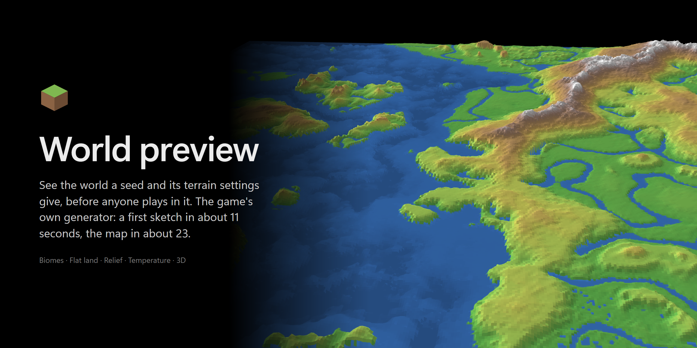
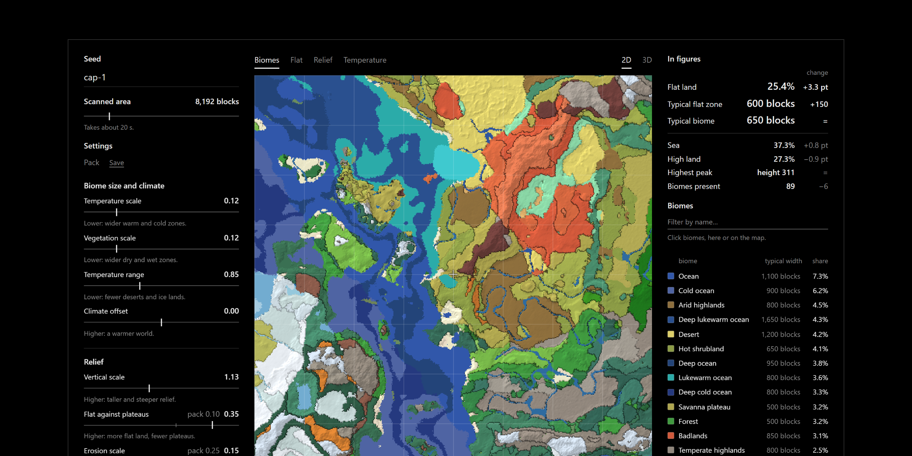
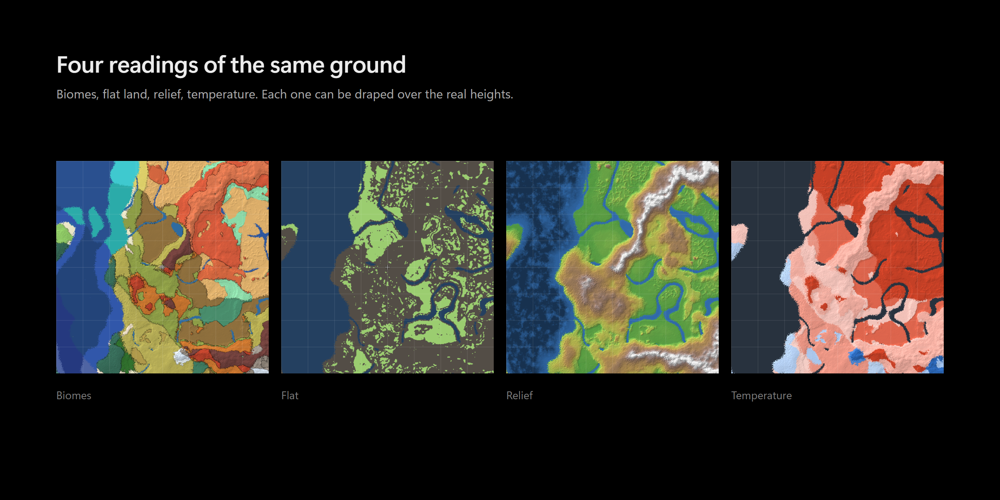
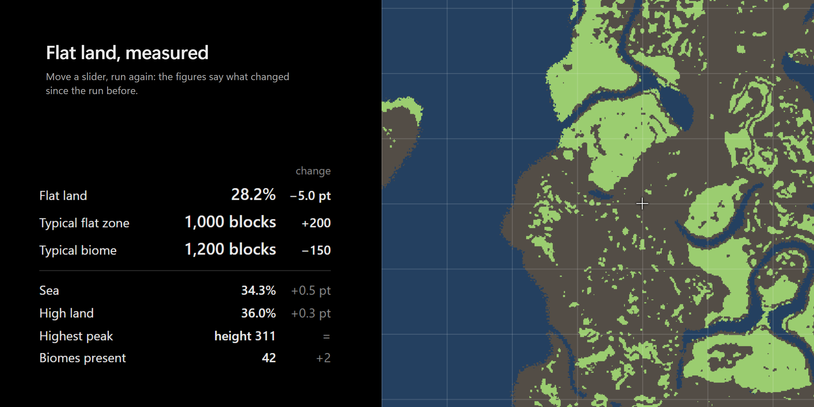
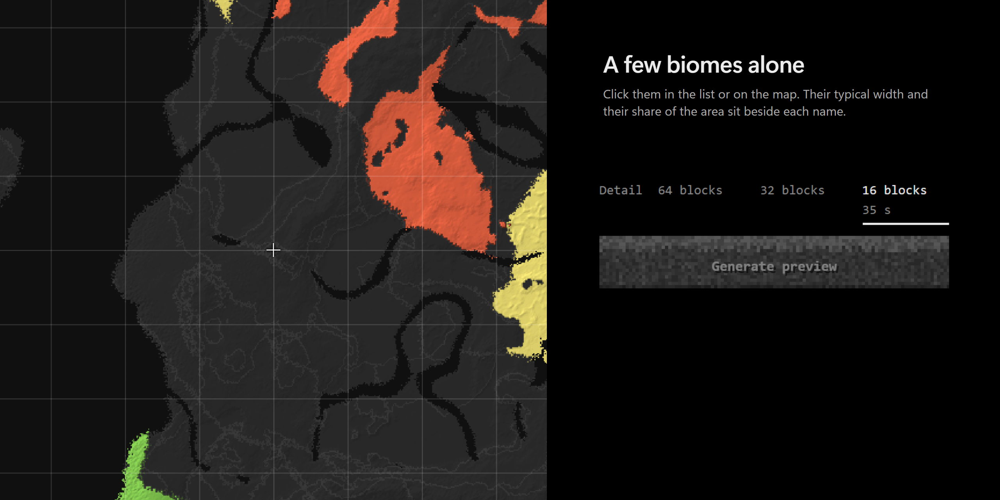
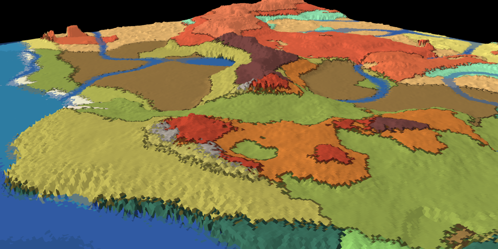

<p align="center">
  
</p>

The world preview shows what a Minecraft seed and a set of terrain values would give, without playing and without generating the world. It asks the game's own generator, through a throwaway server running your Fabric modpack, how high the ground is and which biome sits at the surface, then draws the answer in a small window.

It was written while tuning a modpack's terrain, where every try used to mean starting the game and flying around.

> **Personal project.** Windows only, driven by PowerShell scripts.



- **The real generator, without the world.** A throwaway dedicated server starts with the pack, and a small mod asks the generator two questions on a grid, one point every 16 blocks: how high is the ground, which biome is at the surface. No chunk is generated. Trees, structures and caves are therefore not on the map.
- **A seed and twelve sliders.** The sliders are [Tectonic](https://modrinth.com/mod/tectonic)'s values for the size and climate of biomes, the relief, and the continents. They start at the pack's values; a changed one keeps the pack's value beside it. Sets of values can be kept under a name.
- **Sketches first, then the map.** A coarse sketch takes the map's place while the full map is computed, then finer ones replace it: on the widest area, one point every 256 blocks, then 64, then 32 (see the timings below). The steps of the run are listed where the button is, each with the second it ended at, and the button stops the run.
- **The machine stays usable.** The computation takes half of the processor's threads and runs below the normal priority, so the page and everything else keep answering while it works. It is slower for it, on purpose.
- **Nothing is written to the pack.** A preview changes the config of its own throwaway server only.





- **Figures for the question asked.** Three figures lead: the share of flat land, the width of a typical flat zone, the width of a typical biome. Flat means level ground among level ground: 2 blocks at most to the neighbour points, for at least 5 of the 9 points around. A river does not cut a flat zone.
- **What moved since the run before.** After a second run over the same area, a column shows the change of each figure.



- **A few biomes alone.** A click on a biome, in the list or on the map, shows it alone; more clicks add others. The choice is kept from one run to the next, to follow a biome across tries. The other views have a list of their own, chosen the same way: bands of height, classes of temperature, flat land against slopes and water.



- **Draped over the real heights.** Any view can be shown in 3D, at true scale: one unit is one block, heights included.
- **A try can be kept.** Export writes a folder under `run\preview\exports`: the settings and the figures in one file, and a picture of each view, flat and in 3D.

## Requirements

Nothing to install for whoever already plays Minecraft 26.3 with Fabric mods on Windows:

- Windows 10 or 11. The scripts run under the Windows PowerShell that comes with it.
- Java 25 or newer. The game's launcher downloads its own the first time Minecraft 26 starts, and the preview finds it there (the official launcher, Prism Launcher, the Modrinth app, CurseForge). Otherwise it is looked for through `JAVA_HOME` and the `PATH`.
- Brave or Microsoft Edge: the page opens as a bare window of one of them.
- The mods to preview, for Fabric and Minecraft 26.3, with Tectonic among them, since the sliders are Tectonic's values. Either a **game folder**, the one a launcher plays from, which holds `mods` and `config\tectonic.json` (Tectonic writes that file the first time the game starts with it); or a [packwiz](https://packwiz.infra.link/) pack, the folder that holds `pack.toml`. The packwiz tool itself is not needed.
- Internet the first time: the Fabric server and the game are downloaded once, and the 3D view loads three.js from jsDelivr.

## Running it

### The simple way

1. Download `world-preview-<version>.zip` from the [releases](../../releases) and unzip it anywhere.
2. Double-click `World Preview.cmd`. If Windows warns about a file from the Internet, choose to run it anyway. The first time, a window asks for your game folder, the one that holds `mods` and `config`: go into it, then click Open.
   - With the official launcher it is `%APPDATA%\.minecraft`, unless the profile names another: paste that into the address bar at the top of the window and press Enter.
   - In Prism Launcher, right-click the instance, then Folder: the address of the folder that opens is the one to paste. An instance's folder works too, the game folder is found inside it.
   - Or skip the window: drag the game folder and drop it on `World Preview.cmd`.
3. The page opens. Ask for a first map: it stops at once with a sentence about the Minecraft EULA, which is accepted once, by hand (see just below). Then ask again.

#### The Minecraft EULA, once

The preview runs a Minecraft server of its own on your machine, and Minecraft asks whoever runs a server to accept its [EULA](https://aka.ms/MinecraftEULA). No script does it for you:

1. Read the EULA. If you accept it, open the unzipped folder, then `run`, then `preview` (they exist once a first map has been asked for).
2. Open Notepad, type the single line `eula=true`, and save it there under the name `eula.txt`. In Notepad's save window, set "Save as type" to "All files", or the file ends up named `eula.txt.txt` and is not seen.

The sentence on the page gives the full path of the file it looks for.

The page opens as a window of its own, and an icon sits in the notification area while it runs: amber while a map is computed, a notification when it is ready or has failed, and a menu to reopen the window or to quit. Everything stops by itself about 90 seconds after the window closes.

The chosen folder is kept in `run\pack.txt`; delete that file to be asked again. Nothing is ever written to the game folder: its mods and config are copied into the preview's own.

### From the repository

```powershell
scripts/serve.ps1 -Pack D:\path\to\my-game-folder-or-pack
```

`-Pack` is a game folder or a packwiz pack; it can also come from the environment variable `WORLD_PREVIEW_PACK`. `serve.ps1` opens the page on `http://localhost:25590`. From the repository the mod is built on the first run, which needs a JDK 25 and a few minutes; `scripts/package.ps1` makes the ready-to-use zip, with the mod already built.

The throwaway server works in `run\preview` inside this folder unless `-Dir` names another one. A preview from a shell, without the page:

```powershell
scripts/preview.ps1 -Pack D:\path\to\my-pack -Seed cap-1 -Tectonic @{ vertical_scale = 1.2 }
```

The results land in `<Dir>\out`. `-Samples` goes from 256 to 2048 grid points per side (4096 to 32768 blocks).

With another work folder (`-Dir`), the EULA is accepted in that folder: the line `eula=true` in `<Dir>\eula.txt`, written by whoever owns the folder. Until then a run stops at once with a sentence saying where the file goes.

## Timings

Measured on the machine it was written on (2026-11-11, 8 threads used of 16), on a seed whose small world folder already existed:

| Area | First sketch on screen | Finer sketches | Full map |
| --- | --- | --- | --- |
| 4096 blocks | 12 s | | 17 s |
| 8192 blocks (default) | 12 s | 15 s | 35 s |
| 16384 blocks | 15 s | 27 s | 1 min 40 s |
| 32768 blocks | 11 s | 23 s, 1 min 6 s | 5 min 50 s |

Another machine has its own pace: the page's "takes about" starts from these figures, then follows the last run made on the machine it is on. With every thread at the normal priority the widest map took 3 min 20 s here, and the machine stalled for seconds at a time meanwhile.

Most of the first sketch's wait is the server start. A seed run for the first time took about 10 seconds more, once (22 s to the sketch, 32 s to the map, at 8192 blocks). The first run of all also downloads the game's server, and from the repository builds the mod: a few minutes.

## Limits

- No trees, structures or caves: the map answers "how big, how high, how much", not "is this biome pleasant to walk in".
- The sketches skip the aquifers (the game's underground water and lava) and read fewer points: close to the full map, not proven exact.
- Windows only: the scripts lean on PowerShell, the Windows registry to find the browser, and Windows Forms for the tray icon.
- One run at a time on a machine: a second one waits for the first.
- A game folder may hold mods made for the game's window only. Fabric leaves them alone on the preview's server when they say so; one that does not could stop it. Seen working with a folder of five mods, not with a large pack.

## What is where

| Folder | What it holds |
| --- | --- |
| `mod/` | The Fabric mod that samples the generator, one Gradle build. |
| `page/` | The page, one HTML file. |
| `World Preview.cmd` | The file to double-click. |
| `scripts/` | `start.ps1` (the double-click start, which asks for the game folder), `serve.ps1` (the page's server), `preview.ps1` (one run), `package.ps1` (the ready-to-use zip), `capture.ps1` and `boards.ps1` (pictures of the page). |
| `docs/` | [How it works](docs/setup.md), and `media/` for the illustrations. |

The illustrations above are real pictures of the page, composed by `scripts/boards.ps1` from `docs/media/boards.html`. None is retouched.

## Licence

The code, the page and the scripts of this repository are under the [GNU General Public License v3.0](LICENSE). The mods of the pack you preview are not part of it: each keeps its own licence. Minecraft is a trademark of Mojang; this project is not affiliated with Mojang or Microsoft.
