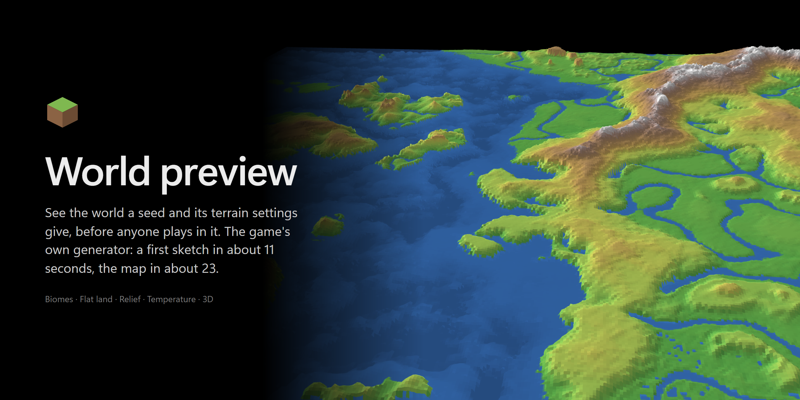
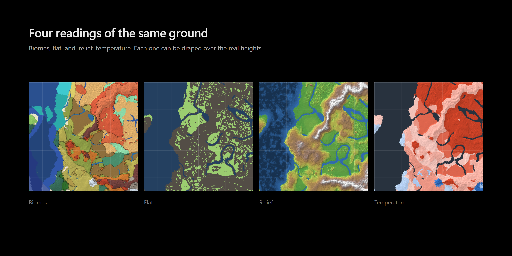
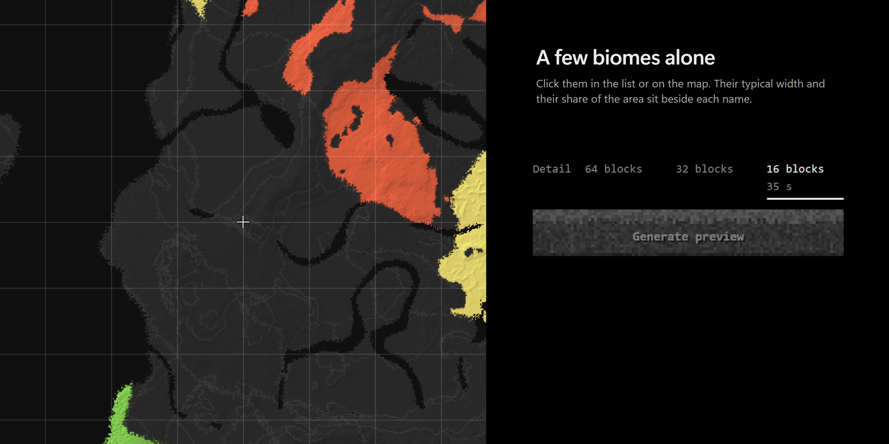
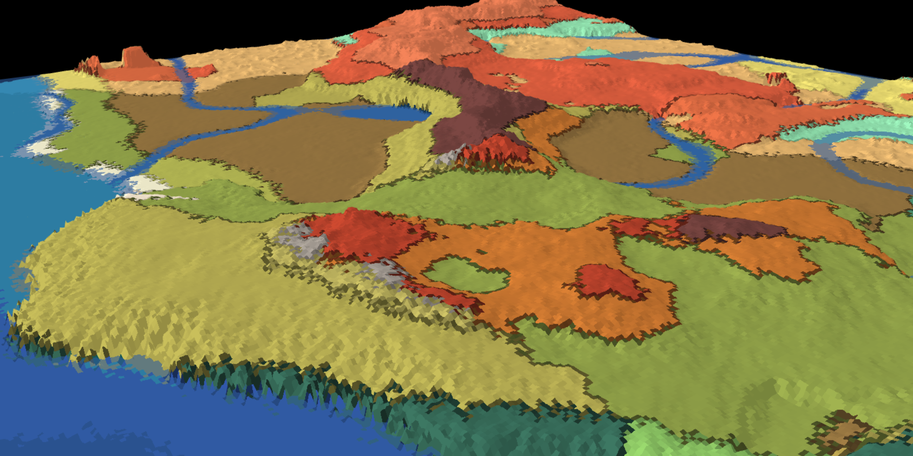

# world-preview



An engine that makes the maps of a Minecraft world from the game's own worldgen, without generating the world. Give it a seed, a Fabric modpack with [Tectonic](https://modrinth.com/mod/tectonic), and the Tectonic values to try: it starts a throwaway dedicated server with that pack and a small mod of its own, asks the generator what it would build on a grid, and writes the answer as files in a folder.

It draws nothing. Outpost Tools, its maintainer's launcher (a repository of its own), is its interface: it runs this engine and draws the maps. Anyone else can run the engine alone and read its files, to build another interface or to measure worlds.

> **Personal project.** Windows only. The run is driven by a small Rust program, `world-preview.exe`, which another Rust program can also call as a library.

## What it asks the generator

- **No chunk is generated.** The mod reads the generator only, never a live world: for each point of a square grid centred on 0,0 (one point every 16 blocks by default), how high the ground is and which biome sits at the surface. So a map of 8192 blocks takes seconds, where real chunks take many minutes. Trees, caves and what a chunk's later steps add are not there.
- **Sketches first.** Coarse passes come before the full grid, each finer than the one before, so an interface can show something within seconds.
- **Then what lies around the map**, after a full map only: up to four cuts through the ground from the bottom of the world to its top, the ore rules the server loaded (those of every mod), and every point where a structure would start.
- **The machine stays usable.** The sampling takes three quarters of the processor's threads and runs below the normal priority.
- **Nothing is written to the pack.** A run changes the config of its own throwaway server only.

## What an interface draws from it

The pictures below are maps drawn from the engine's files by its former page, before the interface moved to Outpost Tools. None is retouched.





## Requirements

- Windows 10 or 11.
- [Rust](https://rustup.rs) the first time, to build the driver from `driver/`: `cargo build --release --manifest-path driver/Cargo.toml` writes `driver/target/release/world-preview.exe`.
- Java 25 or newer. A Minecraft launcher that has started Minecraft 26 already holds one, and the engine finds it there (the official launcher, Prism Launcher, the Modrinth app, CurseForge); otherwise through `JAVA_HOME` and the `PATH`.
- A JDK 25 the first time, to build the mod from `mod/` (a few minutes; the build downloads Gradle and the game).
- The mods, for Fabric and Minecraft 26.3, with Tectonic among them. Either a **game folder**, the one a launcher plays from, which holds `mods` and `config\tectonic.json` (Tectonic writes that file the first time the game starts with it); or a [packwiz](https://packwiz.infra.link/) pack, the folder that holds `pack.toml`. The packwiz tool itself is not needed.
- Internet the first time: the Fabric server and the game are downloaded once.

## Running it

```powershell
driver/target/release/world-preview.exe --pack D:\path\to\my-pack --dir D:\path\to\work --seed cap-1 --tectonic vertical_scale=1.2
```

| Flag | What it is |
| --- | --- |
| `--pack` | A game folder or a packwiz pack. From the environment variable `WORLD_PREVIEW_PACK` when omitted. |
| `--dir` | The work folder of the throwaway server: its mods, its config, one small world per seed. `run\preview` inside this repository when omitted. |
| `--out` | Where the files land. `<dir>\out` when omitted. |
| `--seed` | The world seed, as typed in the game. `cap-1` when omitted. |
| `--tectonic key=value` | A value that replaces that key's in the pack's `config/tectonic.json` for this run: `true`, `false` or a number. Repeatable. An unknown key stops the run. |
| `--samples` | Grid points per side, 512 by default (8192 blocks at a step of 16). Measured up to 4096 with a coarser detail, up to 2048 for a full map. |
| `--step` | Blocks between two grid points, 16 by default. |
| `--detail` | Blocks between two points of the map: the step for the full map, or 2 or 4 times the step to stop at that sketch, which is then the map. Such a map has no cuts, no ore rules and no structures. |
| `--mod` | A jar added to the server on top of the pack's, for a mod being worked on. Repeatable. From `WORLD_PREVIEW_MODS` (paths separated by semicolons) when omitted. |
| `--repo` | This repository, when the program does not sit inside it (it looks up from its own folder for `mod/build.gradle`). |

On failure the program prints the sentence on its error stream and exits with code 1, so a caller can show it. It ends with `Preview ready in <out> (<n> s)`. One run at a time on a machine: a second one waits for the first. If the program is killed mid-run, the throwaway server dies with it.

A Rust program can call the same run as a library instead: `world_preview::run(&options, &mut |line| ...)` (a path dependency on `driver/`), which hands each progress line to the closure as it comes and returns the out folder. `Options::stop`, a flag set from another thread, ends the run and its server; that is how Outpost Tools' native launcher runs it.

### The Minecraft EULA, once per work folder

The engine runs a Minecraft server, and Minecraft asks whoever runs a server to accept its [EULA](https://aka.ms/MinecraftEULA). No script does it: read it and, if you accept it, write the single line `eula=true` in `<Dir>\eula.txt`. Until then a run stops at once with a sentence that gives the full path of the file.

## What it outputs

Everything lands in the out folder. A run removes the files of the run before first, then writes each file beside its place and moves it there in one go, so a reader never sees half of one.

The grid: `samples` points a side, `step` blocks apart, the first point (north-west) at `originX`, `originZ`. Point `i` is at column `i % samples`, row `i / samples`, that is at `x = originX + column * step`, `z = originZ + row * step`: row by row from north to south, each row from west to east. Every `.bin` file is little-endian.

| File | When | What it holds |
| --- | --- | --- |
| `preview.json` | The map is done | `seed`, `samples`, `step`, `originX`, `originZ`, `seaLevel`, `minY`, `maxY`; `biomes`, the biomes of `biomes.bin` in index order, each `{ id, temperature }`; `possible`, every biome the generator can place, each `{ id, underground }` (tagged `c:is_underground`); `sampleMillis`. Its presence means the run succeeded. |
| `heights.bin` | With it | One int16 per point: the ground height from the generator, heightmap `OCEAN_FLOOR_WG`, so a sea bed shows its depth. |
| `biomes.bin` | With it | One uint16 per point: an index into `biomes` of `preview.json`. |
| `coarse.json`, `coarse-<step>-heights.bin`, `coarse-<step>-biomes.bin` | During the run, each pass replacing the one before | A sketch, in the same form as the map at a coarser step. Its heights leave out the aquifers. |
| `partial.json`, `partial-heights.bin`, `partial-biomes.bin` | During the full pass, once a second | The points sampled so far, with the grid of `preview.json`, `done` and `total` tiles, and `biomes`, every biome the generator can place; a biome of `0xFFFF` is a point not sampled yet. |
| `progress.json` | Every half second while the game runs | `{ pass, step, done, total }`: the pass under way (`sketch`, `map`, or `extras`), its step in blocks, and how many of its tiles of 16 x 16 points are done. |
| `section.json`, `section-<n>.bin` | After a full map | Up to four cuts, west to east across the whole square, along rows of the map chosen for the most varied ground. One byte per block, row by row from the top of the world down: 0 air, 1 rock, 2 water, 3 lava. |
| `ores.json` | After a full map | Every placement of an ore feature with its steps, as a data pack writes them, and for each biome the placements it lists once every mod has added its own. |
| `structures.json` | After a full map | `structures`, every structure the overworld can place, `{ id, set, step }`; `points`, one row per start inside the square, `[index into structures, x, z]` in blocks. |
| `timing.json` | At the end | `{ workMillis }`: how long the mod's own work took, without the game's start and stop. |
| `run.json` | At the end, written by the script | `{ seed, tectonic }`: what the run was asked, a switch as 1 or 0. |

[docs/setup.md](docs/setup.md) tells how each pass is made and what each file leaves out.

## Timings

Measured on the machine it was written on (2026-11-11, 8 threads used of 16, since raised to 12), on a seed whose small world folder already existed:

| Area | First sketch | Finer sketches | Full map |
| --- | --- | --- | --- |
| 4096 blocks | 12 s | | 17 s |
| 8192 blocks (default) | 12 s | 15 s | 35 s |
| 16384 blocks | 15 s | 27 s | 1 min 40 s |
| 32768 blocks | 11 s | 23 s, 1 min 6 s | 5 min 50 s |

A coarser detail, measured on the same machine on 2026-11-13 (seed cap-1):

| Area | A point every 64 blocks | A point every 32 blocks |
| --- | --- | --- |
| 8192 blocks | 16 s | 19 s |
| 65536 blocks | 57 s (125 biomes of 140) | 3 min 26 s (126 of 140) |

Most of the first sketch's wait is the server start. A seed run for the first time took about 10 seconds more, once. The first run of all also downloads the game's server and builds the mod: a few minutes.

## Limits

- No trees or caves on the map: it answers "how big, how high, how much", not "is this biome pleasant to walk in".
- A structure is the point where it would start, not what it covers. Compared once with a real world of the same pack: the 111 starts its chunks held were all at the point given, 43 of them one chunk aside.
- The sketches skip the aquifers and read fewer points: close to the full map, not proven exact.
- A game folder may hold mods made for the game's window only. Fabric leaves them alone on a server when they say so; one that does not could stop it.

## What is where

| Path | What it holds |
| --- | --- |
| `mod/` | The Fabric mod that samples the generator, one Gradle build; its six classes sit flat in `mod/src`. |
| `driver/` | The driver, in Rust: one run, from the pack to the out folder. A program (`world-preview.exe`) and a library (`world_preview::run`). |
| `scripts/serve.ps1`, `page/preview.html` | The former page and its local server, kept only while Outpost Tools' page launcher still shows them in a frame. Not part of the engine; they go once that launcher stops calling them. |
| `docs/setup.md` | How a run works, pass by pass. |

## Licence

The code and the scripts of this repository are under the [GNU General Public License v3.0](LICENSE). The mods of the pack you run it with are not part of it: each keeps its own licence. Minecraft is a trademark of Mojang; this project is not affiliated with Mojang or Microsoft.

The page is set in [IBM Plex Mono](https://github.com/IBM/plex), by IBM under the [SIL Open Font License 1.1](https://github.com/IBM/plex/blob/master/LICENSE.txt), embedded in the page (release `@ibm/plex-mono@2.5.0`).
